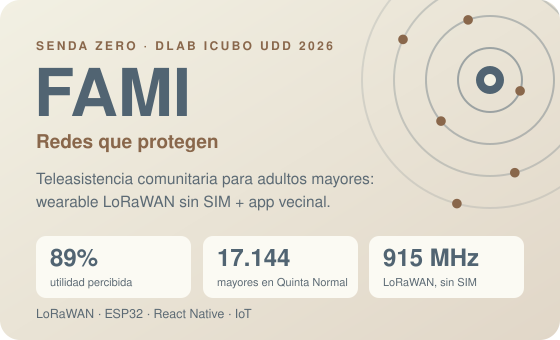
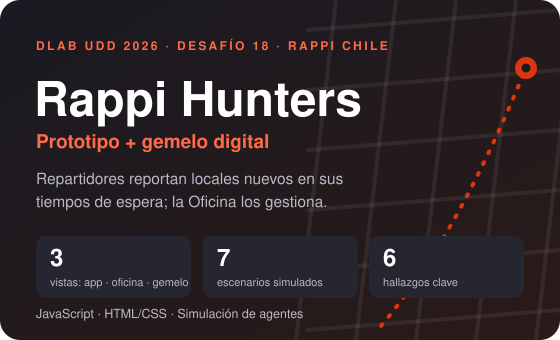

<picture>
  <source media="(prefers-color-scheme: dark)" srcset="assets/banner-dark.svg">
  
</picture>

  
  
  

## Perfil

Soy **estudiante de Ingeniería Civil Industrial en la Universidad del Desarrollo** (Santiago, Chile; egreso previsto en diciembre de 2026). Me interesa entender cómo funcionan los procesos, encontrar dónde se traban y probar mejoras con datos antes de implementarlas.

Este perfil funciona como mi **portafolio**: reúne proyectos donde apliqué optimización de procesos, análisis de datos, modelación y evaluación económica a problemas reales de empresas y comunidades.

## Competencias

| Área | Qué hago | Herramientas |
|---|---|---|
| **Optimización de procesos y operaciones** | Detecto cuellos de botella, capacidad y niveles de servicio (SLA) | Modelación, simulación |
| **Análisis de datos** | Limpieza, análisis y visualización para tomar decisiones; enseño la materia a nivel universitario | R · RStudio · Excel · Python |
| **Modelación y simulación** | Gemelos digitales y simulación basada en agentes, con escenarios y semillas reproducibles | JavaScript |
| **Evaluación de negocios** | Costeo unitario, punto de equilibrio, validación de precios y dimensionamiento de mercado (TAM/SAM/SOM) | Excel |
| **Prototipado de soluciones** | Prototipos funcionales y documentación de pruebas | HTML · CSS · JS · Python |
| **Sostenibilidad y responsabilidad pública** | Minor en estrategias para un mundo sustentable | |
| **Liderazgo y gestión de equipos** | Coordinación de voluntarios y comunidades | |

## Proyectos

  
  

<table>
<tr>
<td width="50%" valign="top">

**FAMI · Redes que Protegen**

- **Problema:** una caída sin ayuda por más de 1 hora duplica la mortalidad de un adulto mayor, y en una emergencia masiva las redes celulares colapsan.
- **Solución:** un wearable discreto con LoRaWAN, sin SIM, y una app que avisa primero a los vecinos y familiares más cercanos.
- **Validación:** 4 ciclos de co-diseño en Quinta Normal; el 89 % de los encuestados lo calificó útil o muy útil.
- **Ingeniería aplicada:** modelo de negocio híbrido (hardware + suscripción), costeo unitario, punto de equilibrio entre los meses 18 y 24, validación de precios (Gabor-Granger y Van Westendorp) y dimensionamiento TAM/SAM/SOM.

[Ver proyecto →](https://github.com/FX010/fami-redes-que-protegen)

</td>
<td width="50%" valign="top">

**Rappi Hunters**

- **Problema:** hay locales que aún no están en Rappi, y los repartidores tienen tiempos de espera sin aprovechar.
- **Solución:** un Modo Hunter para reportar locales, una Oficina que los gestiona y un gemelo digital que prueba las reglas antes de lanzarlas.
- **Hallazgo:** el cuello de botella es la oficina, no el repartidor: con 1.000 repartidores el primer contacto pasa de ~17 h a ~109 h.
- **Ingeniería aplicada:** simulación basada en agentes, análisis de capacidad y SLA de 48 h, 7 escenarios y pruebas de mutación para validar el modelo.

[▶ Demo](https://fx010.github.io/Dlab-sem-2/) · [Repositorio](https://github.com/FX010/Dlab-sem-2) · [Informe](https://github.com/FX010/Dlab-sem-2/blob/main/docs/Informe_Pruebas.md)

</td>
</tr>
</table>

*Además construyo herramientas personales de automatización con Python, bots de Telegram y Google Apps Script (repositorios privados).*

## Experiencia

| Periodo | Rol | Qué hice |
|---|---|---|
| **ago. 2024 – actualidad** | **Ayudante de Análisis de Datos** Universidad del Desarrollo | Imparto clases de Análisis de Datos y RStudio a nivel universitario. Desarrollo materiales didácticos y visualizaciones, y refuerzo las habilidades analíticas y de programación de los estudiantes. |
| **ene. – feb. 2021** | **Asistente en control de gestión** Amaco · Servicios Ambientales, Curicó | Gestión de licitaciones públicas y privadas con foco en ChileCompra (Mercado Público), seguimiento de clientes, control de inventario y apoyo administrativo. |

## Formación

- **Licenciatura en Ciencias de la Ingeniería · Ingeniería Civil Industrial**, Universidad del Desarrollo (2020 – dic. 2026). Optimización de procesos, gestión de operaciones, análisis de datos y resolución de problemas complejos.
- **Minor en Estrategias para un Mundo Sustentable**, UDD (ago. 2026).
- **Certificado de Formación en Responsabilidad Pública**, UDD (jun. 2024).
- **Lifelong Learning 2025** y **Cybersecurity Awareness Learner 2025**, CertiProf (may. 2025).
- **Python: Primeros Pasos**, Credly by Pearson (nov. 2022).
- **dLab · iCubo UDD (2026):** programa interdisciplinario de diseño, ingeniería y negocios donde nacieron los dos proyectos de arriba.

## Voluntariado y liderazgo

- **Coordinador General · TECHO-Chile** (mar. 2021 – ago. 2022): gestioné cuatro campamentos en Cerro 18, Lo Barnechea, coordiné proyectos con la comunidad e impulsé iniciativas educativas junto a instituciones y organizaciones.
- **Voluntario · Gesta, Fundación Marista por la Solidaridad** (2013 – 2019): proyectos para niños en situación de riesgo social en Curicó, trabajando con la municipalidad y liderando equipos en colonias de verano e invierno.

## Herramientas

## Cómo trabajo

- **Primero entender, después construir:** pruebo supuestos con modelos y simulaciones antes de comprometer diseño.
- **Honestidad con los datos:** lo simulado se rotula como simulado y lo supuesto como supuesto.
- **Entregables que se entienden solos:** README claro, demo en vivo e informe con lo que se probó y lo que no.

## Contacto

Escríbeme por [LinkedIn](https://www.linkedin.com/in/agbravos).
