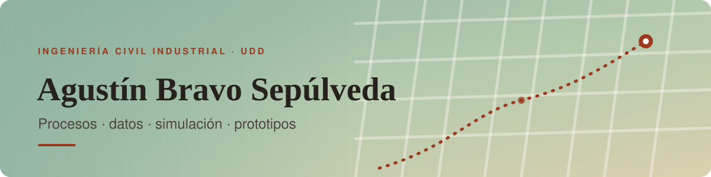

<picture>
  <source media="(prefers-color-scheme: dark)" srcset="assets/banner-dark.svg">
  
</picture>

## Hola, soy Agustín 👋

Me gusta convertir ideas en **prototipos que se pueden tocar**: apps web de un solo archivo, simulaciones para probar supuestos antes de construir, y automatizaciones que me ahorran trabajo repetitivo.
Participo en **dLab UDD**, donde trabajo en innovación y desarrollo de producto con foco en problemas reales de empresas.

- 🧪 Prototipos web sin dependencias (HTML, CSS y JavaScript puro)
- 🤖 Simulación basada en agentes y gemelos digitales
- ⚙️ Automatización personal con Python, bots de Telegram y Google Apps Script *(repos privados)*
- 📝 Documento todo: informes de pruebas, hallazgos y límites

## Proyecto destacado

<table>
<tr>
<td width="46%" valign="top">
  
</td>
<td valign="top">

### [Rappi Hunters](https://github.com/FX010/Dlab-sem-2)
Programa donde los repartidores reportan locales que aún no están en Rappi **mientras esperan** un pedido. Incluye app del repartidor, Oficina de gestión y un **gemelo digital** que simula si las reglas aguantan a escala.

**Lo más interesante:** el modelo mostró que el cuello de botella es la oficina, no el repartidor.

`JavaScript` · `HTML/CSS` · `Simulación de agentes`

[▶ Demo](https://fx010.github.io/Dlab-sem-2/) · [Repositorio](https://github.com/FX010/Dlab-sem-2) · [Informe de pruebas](https://github.com/FX010/Dlab-sem-2/blob/main/docs/Informe_Pruebas.md)

</td>
</tr>
</table>

## Herramientas

## Cómo trabajo

- **Primero entender, después construir:** pruebo supuestos con simulaciones antes de comprometer diseño.
- **Honestidad con los datos:** lo simulado se rotula como simulado y lo supuesto como supuesto.
- **Entregables que se entienden solos:** README claro, demo en vivo e informe con lo que se probó *y* lo que no.
