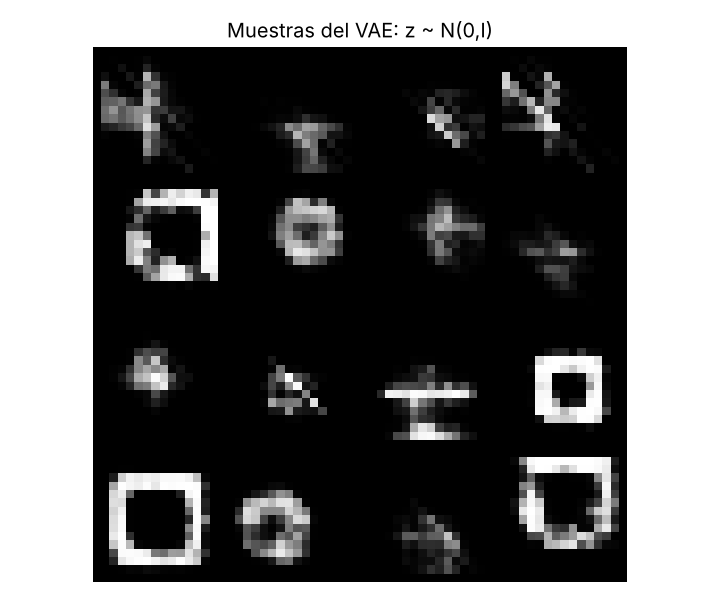
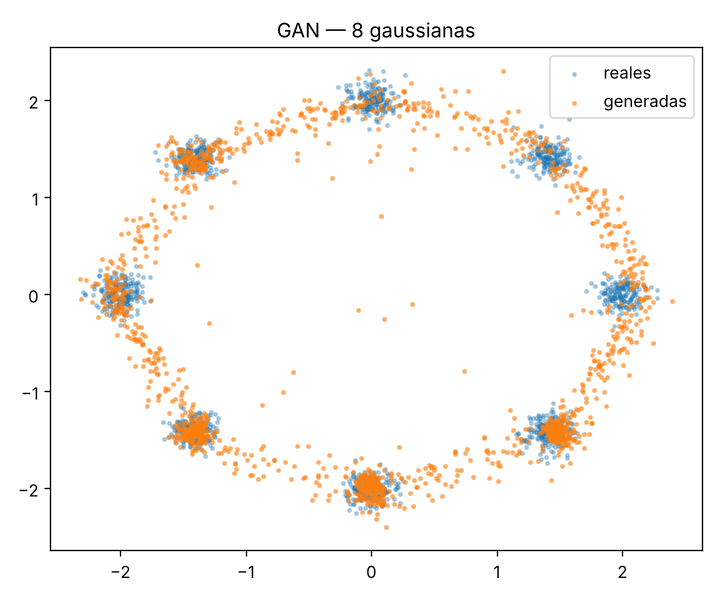
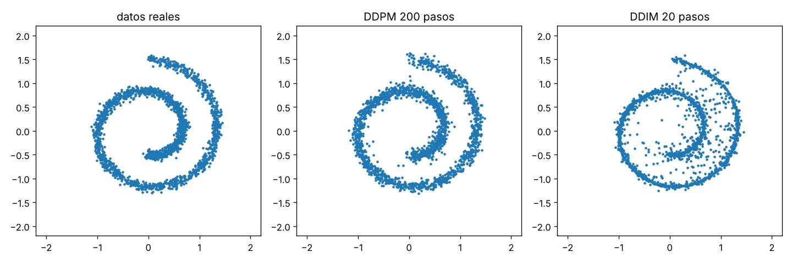
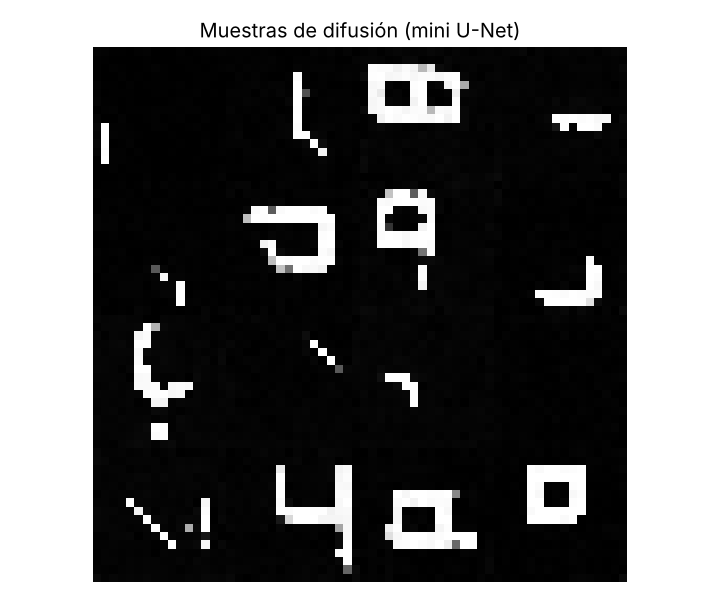

# Curso de 8 semanas: construye tus propias redes neuronales e IA generativa

**16 de noviembre de 2026 → 10 de enero de 2027** · ≈ 12 h/semana (≈ 100 h) · Python/PyTorch · todo corre en **CPU**

Un curso completo, **práctico y verificado**, para pasar de “sé programar” a **escribir desde cero** autograd, MLP, CNN, un GPT, un VAE, una GAN, un modelo de difusión, LoRA, DPO y un sistema RAG, y a **medir y explicar** lo que construyes. Está construido sobre tu [hoja de ruta original](recursos/hoja-de-ruta-original.md): sus 5 pasos, sus 7 módulos y su biblioteca de fuentes se convierten aquí en un plan semanal ejecutable.

> **Cómo está hecho:** cada guía semanal combina *intuición + matemática + diagrama de dimensiones + código reproducible*. Los números de resultados que aparecen en las guías **salen de ejecuciones reales** de los scripts de `codigo/` (CPU, datos sintéticos, semilla fija); cuando un resultado fue ambiguo, lo digo.

## 🚀 Empieza aquí

```bash
python3 -m venv .venv && source .venv/bin/activate
pip install -r codigo/requirements.txt
python codigo/pruebas_rapidas.py        # 19 pruebas en < 1 min: tu entorno y el código funcionan
```

Luego lee el [**plan maestro**](guias/00-plan-maestro.md) (20 min) y abre la [Semana 1](guias/semana-1.md).

## 🗺️ El curso

| Sem. | Fechas | Tema | Guía | Código |
|---|---|---|---|---|
| **1** | 16–22 nov | Cimientos: tensores, cálculo, **autograd desde cero** | [guía](guias/semana-1.md) | [`semana1_micrograd`](codigo/semana1_micrograd) |
| **2** | 23–29 nov | MLP vectorizado, backprop manual, optimizadores | [guía](guias/semana-2.md) | [`semana2_mlp`](codigo/semana2_mlp) |
| **3** | 30 nov–6 dic | Ingeniería de entrenamiento, normalización, **mapeo** | [guía](guias/semana-3.md) | [`semana3_entrenamiento`](codigo/semana3_entrenamiento) |
| **4** | 7–13 dic | CNN, residuales, RNN/LSTM/GRU | [guía](guias/semana-4.md) | [`semana4_arquitecturas`](codigo/semana4_arquitecturas) |
| **5** | 14–20 dic | **Transformer**: BPE, atención, RoPE, tu **GPT** | [guía](guias/semana-5.md) | [`semana5_transformer`](codigo/semana5_transformer) |
| **6** | 21–27 dic | Modelos generativos I: **VAE y GAN** | [guía](guias/semana-6.md) | [`semana6_vae_gan`](codigo/semana6_vae_gan) |
| **7** | 28 dic–3 ene | Modelos generativos II: **difusión** + LLM a escala | [guía](guias/semana-7.md) | [`semana7_difusion`](codigo/semana7_difusion) |
| **8** | 4–10 ene | **LoRA, DPO, RAG, agentes, interpretabilidad** + cierre | [guía](guias/semana-8.md) | [`semana8_adaptacion`](codigo/semana8_adaptacion) |
| ★ | 10 ene | [**Proyecto final integrador**](proyecto/proyecto-final.md) (4 rutas) | | |

## 📦 Qué incluye

| Carpeta | Contenido |
|---|---|
| [`guias/`](guias) | Plan maestro + 8 guías semanales (objetivos, plan día a día, teoría, resultados de referencia, ejercicios, errores comunes, autoevaluación con respuestas, checklist) |
| [`codigo/`](codigo) | 28 archivos Python: scripts y módulos por semana, `comun.py` (datos sintéticos) y `pruebas_rapidas.py` |
| [`recursos/`](recursos) | [Biblioteca de fuentes por semana](recursos/biblioteca.md) · [Guía de mapeo de redes (4 niveles)](recursos/mapeo-redes.md) · [Chuleta de fórmulas y *shapes*](recursos/chuleta-formulas.md) · [Glosario ES↔EN](recursos/glosario.md) |
| [`proyecto/`](proyecto) | Proyecto final con 4 rutas, cronograma y rúbrica |
| [`presentacion/`](presentacion) | Presentación de 15 diapositivas: [.pptx](presentacion/Curso-IA-Generativa-8-semanas.pptx) editable y [.pdf](presentacion/Curso-IA-Generativa-8-semanas.pdf), con notas del orador |

## ✅ Resultados verificados (resumen)

| Semana | Verificación | Resultado |
|---|---|---|
| 1 | Autodiff vs derivada numérica | error relativo ≈ 1e-10; MLP escalar 98 % en medias lunas |
| 2 | Backprop manual vs autograd de PyTorch | diferencia ≈ 1e-8; 99,3 % en espirales |
| 3 | LM de caracteres vs cota de entropía | **0,205 vs 0,202** nats/carácter |
| 4 | CNN vs MLP (datos con traslaciones) | **92,4 %** (2 836 params) vs **55,2 %** (31 140 params) |
| 5 | **GPT propio** (335 k params) | **0,232** vs cota **0,203**; 100 % de 500 frases gramaticales (T=0,8) |
| 6 | VAE / GAN | compromiso β medido; 8/8 modos cubiertos |
| 7 | DDPM / DDIM en 2D | precisión **99,3 %** / **95,0 %** (línea base 39,9 %) |
| 8 | LoRA / DPO | LoRA: 6 % → **100 %** de estilo objetivo, congela los pesos y se fusiona sin pérdida; **DPO puro degrada** la gramática (90 → 32 %), DPO+SFT lo corrige |

Figuras de referencia generadas por los scripts: [`codigo/salidas/`](codigo/salidas).

| VAE (S6) | GAN (S6) |
|---|---|
|  |  |
| **DDPM 2D (S7)** | **Difusión de imágenes (S7)** |
|  |  |

## ⚠️ Alcance y límites (léelos)

- **Datos sintéticos a propósito:** los scripts usan datos generados (formas 16×16, corpus de una gramática pequeña, espirales) para que corran en minutos en CPU y, además, para tener **cotas exactas** (p. ej. la entropía del corpus) con las que probar que tu código es correcto. Cada guía indica cómo cambiarlos por MNIST, CIFAR o Tiny Shakespeare.
- **Son modelos pequeños.** Reproducen la *mecánica* de los modelos grandes, no su calidad. Los experimentos son de **una semilla** salvo que se indique: úsalos como punto de partida y repítelos con más semillas (los ejercicios te lo piden).
- **Resultados ambiguos señalados:** RNN/LSTM/GRU (depende de la semilla), RAG (ajustado sobre su propio conjunto de 10 preguntas) y DPO (inestable, con degradación). No los “maquillé”.
- **No verificado aquí:** el bucle de *tool calling* de la Semana 8 (requiere clave de API) y los enlaces externos (sin acceso a internet en el entorno de preparación).
- **Lo que el curso no cubre:** aprendizaje por refuerzo en profundidad, modelos multimodales, modelos de espacio de estados (Mamba), *mixture of experts* en detalle, entrenamiento distribuido real. Están señalados como siguientes pasos en el plan maestro.

## Licencia y uso

Material de estudio personal. El código es tuyo para modificar, ejecutar y reutilizar; los recursos externos de la biblioteca pertenecen a sus autores.
