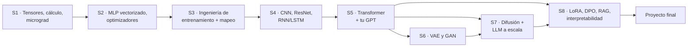

# Plan maestro · 8 semanas (16 nov 2026 – 10 ene 2027)

Este documento es tu **mapa y tu método**. Léelo completo antes de la Semana 1 (≈ 20 min) y vuelve a él cada domingo.

## 1. El curso de un vistazo



| Sem. | Fechas | Tema | Lo que construyes | Prueba de que lo lograste |
|---|---|---|---|---|
| **1** | 16–22 nov | Cimientos + autograd escalar | `micrograd` propio | gradient check < 1e-6 |
| **2** | 23–29 nov | MLP vectorizado, optimizadores | MLP NumPy con backprop manual → PyTorch | autograd == backprop manual; ≥ 95 % en espirales |
| **3** | 30 nov–6 dic | Entrenamiento y mapeo | LM de caracteres + informe de diagnóstico | pérdida cerca de la cota de entropía |
| **4** | 7–13 dic | CNN, residuales, RNN | CNN/ResNet medidas contra MLP | CNN > MLP con menos parámetros |
| **5** | 14–20 dic | **Transformer** | BPE + atención + **GPT** | val ≈ cota; texto gramatical |
| **6** | 21–27 dic | VAE y GAN | VAE y GAN con métricas honestas | ELBO derivado; cobertura de modos |
| **7** | 28 dic–3 ene | Difusión + LLM a escala | DDPM/DDIM (2D e imágenes) | precisión > 95 % en 2D |
| **8** | 4–10 ene | Adaptación + cierre | LoRA, DPO, RAG + **proyecto final** | proyecto presentado |

**Carga:** ≈ 12 h/semana (semana 5 y 8: ≈ 14 h) → ≈ **100 h** en total. Si sumas lo opcional (Karpathy *reproduce GPT-2*, CS336), ≈ 130 h.

## 2. Ritmo semanal tipo (12 h)

| Día | Horas | Bloque | Lógica |
|---|---|---|---|
| Lun | 1,5–2 | **Entender:** video/lectura principal | intuición primero |
| Mar | 1,5–2 | **Derivar:** matemática en papel | lo escrito a mano se recuerda |
| Mié | 1,5–2 | **Construir:** código desde cero, sin mirar la solución | el aprendizaje real ocurre aquí |
| Jue | 1,5–2 | **Experimentar:** correr scripts, cambiar hiperparámetros, romper cosas | desarrolla criterio |
| Vie | 1,5–2 | **Leer:** paper/blog de la semana + notas | acostumbra al lenguaje de la frontera |
| Sáb | 3–4 | **Proyecto semanal** | integra y consolida |
| Dom | 1 | **Repaso + autoevaluación + planificar** | repaso espaciado |

### Plan B (≈ 8 h/semana): qué recortar
Úsalo en semanas de exámenes, trabajo o fiestas (S6 y S7 caen en Navidad/Año Nuevo).

| Mantén (núcleo irrenunciable) | Recorta |
|---|---|
| El **código desde cero** del día Mié y el script principal de la semana | La lectura de papers (haz solo el abstract + figuras) |
| Derivación en papel (Mar) | Ejercicios “Reto” y la mitad de los “Intermedios” |
| Autoevaluación del domingo | Videos largos: ve solo los capítulos indicados en negrita |

Si aun así te atrasas: **no acumules**. Salta lo opcional pero nunca la Semana 1–2 (cimientos) ni la 5 (Transformer): todo lo demás depende de ellas.

## 3. Método de estudio (lo que marca la diferencia)

1. **Implementa antes de leer la solución.** Lee el enunciado, intenta 20 min, recién entonces abre el código de referencia. Luego **reescríbelo sin mirarlo**.
2. **Predice antes de ejecutar.** Antes de correr un experimento, escribe qué esperas ver. El error de predicción es donde aprendes.
3. **Un experimento no es evidencia.** Repite con ≥ 3–5 semillas y reporta media ± desviación. Varias guías de este curso te lo recuerdan con ejemplos reales (RNN vs GRU, DPO).
4. **Mide siempre calidad *y* diversidad, entrenamiento *y* validación.**
5. **Cuaderno de aprendizaje** (un Markdown por semana): 5–10 líneas “lo que entendí”, “lo que me confundió”, “cómo lo arreglé”.
6. **Registro de errores:** cada bug que te costó > 30 min va a una tabla (síntoma → causa → cómo lo detecté). Es tu mejor manual personal.
7. **Repaso espaciado:** convierte cada autoevaluación en tarjetas (Anki o papel) y repásalas a los 1, 3, 7 y 21 días.
8. **Enseña:** explica a una persona (o en voz alta) un concepto por semana. Si no puedes explicarlo sin diapositivas, no lo dominas aún.
9. **Control de versiones:** crea **tu propio repositorio** de práctica (`mi-curso-ia/`), un commit por día con mensaje claro.
10. **Mapea todo:** cada tensor nuevo lleva su *shape* en un comentario (`# [B,T,C]`). Es el hábito que más bugs previene.

## 4. Preparación del entorno (30–60 min, antes de la Semana 1)

```bash
# 1. Python 3.10+ y un entorno virtual
python3 -m venv .venv && source .venv/bin/activate          # Windows: .venv\Scripts\activate

# 2. Dependencias
pip install -r curso-ia-generativa/codigo/requirements.txt

# 3. Verificación (19 pruebas, < 1 minuto en CPU)
python curso-ia-generativa/codigo/pruebas_rapidas.py
```

- **No necesitas GPU** para ningún script del curso (todo corre en CPU en 1–5 min con datos sintéticos).
- Para **datos reales** (MNIST, CIFAR-10, Tiny Shakespeare) o modelos grandes, usa **Google Colab** o **Kaggle Notebooks** (GPU gratuita con cupo limitado).
- Editor sugerido: VS Code con la extensión de Python/Jupyter. Los scripts son archivos `.py` simples: ejecútalos y modifícalos.
- Si `pip install torch` pesa demasiado, instala la versión CPU desde la página oficial de PyTorch (el selector genera el comando para tu sistema).

## 5. Diagnóstico de prerrequisitos (¿listo para empezar?)

Responde sin ayuda (10 min). Si fallas ≥ 4, dedica la primera semana a reforzar con *Mathematics for Machine Learning* y las notas de CS231n.

1. ¿Qué shape tiene `A @ B` si `A:[5,3]` y `B:[3,7]`?
2. Calcula $\frac{d}{dx}\,\sigma(3x)$ en $x=0$.
3. ¿Qué es la regla de la cadena para $f(g(h(x)))$?
4. Define media y varianza de una variable aleatoria; ¿cuánto vale $\mathrm{Var}(aX)$?
5. ¿Qué es la entropía cruzada entre dos distribuciones discretas?
6. ¿Qué hace un `for` que recorre una lista y acumula una suma? (Escríbelo en Python.)
7. ¿Qué diferencia hay entre una lista de Python y un arreglo de NumPy?
8. ¿Qué significa que un modelo “sobreajusta”?
9. ¿Para qué se divide un conjunto de datos en train/val/test?
10. ¿Qué es un gradiente en $\mathbb{R}^n$?

<details><summary>Respuestas</summary>

1. `[5,7]`. 2. $3\sigma'(0)=3\cdot0.25=0.75$. 3. $f'(g(h))\,g'(h)\,h'(x)$. 4. $\mathbb{E}[X]$ y $\mathbb{E}[(X-\mu)^2]$; $\mathrm{Var}(aX)=a^2\mathrm{Var}(X)$. 5. $H(p,q)=-\sum_i p_i\log q_i$. 6–7. Código y comparación de tipos. 8. Rinde bien en train y mal en datos nuevos. 9. Entrenar, elegir hiperparámetros, y evaluar sin sesgo. 10. El vector de derivadas parciales; apunta a la dirección de máximo crecimiento.
</details>

## 6. Rúbrica de autoevaluación (úsala en las semanas 4 y 8)

Puntúa 0 = no puedo · 1 = con ayuda · 2 = solo, con apuntes · 3 = solo y puedo enseñarlo.

| Habilidad | S4 | S8 |
|---|---|---|
| Derivar backprop de una capa densa y de softmax+CE | | |
| Implementar autograd escalar | | |
| Elegir y justificar inicialización, activación y optimizador | | |
| Diagnosticar un entrenamiento que no converge | | |
| Calcular *shapes* y parámetros de CNN / Transformer | | |
| Implementar atención causal y explicar $\sqrt{d_k}$ | | |
| Entrenar un GPT pequeño y evaluar con perplejidad | | |
| Derivar el ELBO del VAE | | |
| Explicar el juego GAN y sus fallas | | |
| Explicar y programar difusión (DDPM/DDIM) | | |
| Implementar LoRA y explicar QLoRA | | |
| Derivar DPO y explicar cuándo falla | | |
| Diseñar y evaluar un RAG | | |
| Interpretar/mapear una red (≥ 2 herramientas) | | |

**Meta final:** ≥ 2 en todo y ≥ 3 en al menos 6 habilidades (las de tu proyecto).

## 7. Riesgos comunes y cómo evitarlos

| Riesgo | Antídoto |
|---|---|
| “Tutorial hell” (ver videos sin construir) | Regla: **por cada hora de video, 2 de código** |
| Miedo a la matemática | Derivaciones **numéricas** con ejemplos pequeños (como en Semana 1) antes de la fórmula general |
| Perfeccionismo | Entregable mínimo funcional primero; mejora después |
| Frustración con un bug de *shapes* | `print(x.shape)` en cada línea; hooks de `shape_tracking.py`; sobreajustar un batch |
| Comparar modelos con una sola corrida | ≥ 3 semillas; reporta dispersión |
| Agotamiento | Un domingo de descanso real cada dos semanas; el Plan B existe para usarse |

## 8. Después de las 8 semanas (próximos 3 meses)

1. **Reproducir GPT-2 (124 M)** de principio a fin (Karpathy) con datos reales y GPU.
2. **Stanford CS336** completo (sistemas, escalado, datos y alineamiento).
3. **Un proyecto de investigación aplicada** en tu dominio con evaluación seria y publicación del repo.
4. Leer 1 paper por semana (lista en [`recursos/biblioteca.md`](../recursos/biblioteca.md)) y reimplementar uno cada mes.
5. Explorar lo que este curso solo rozó: aprendizaje por refuerzo, modelos multimodales, modelos de espacio de estados (Mamba), *mixture of experts*, evaluación de agentes.

[Empezar: Semana 1 →](semana-1.md)
